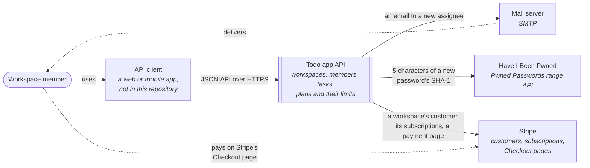
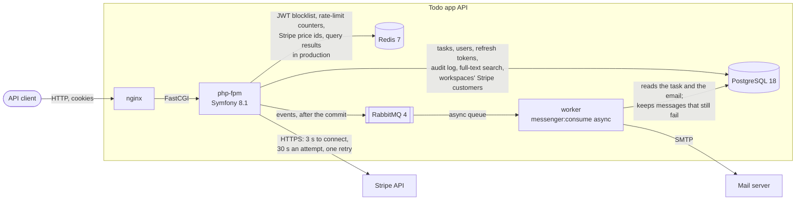
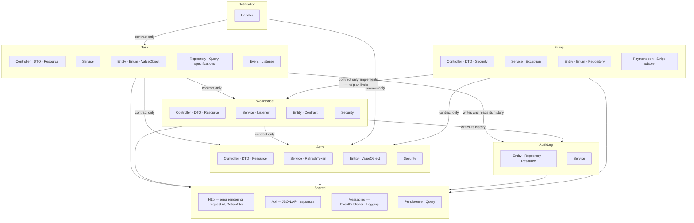
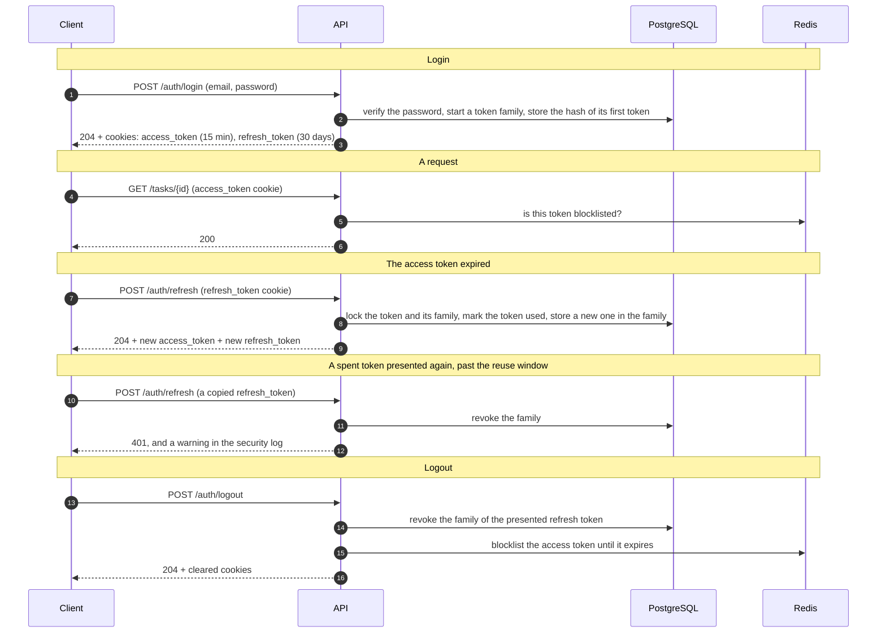
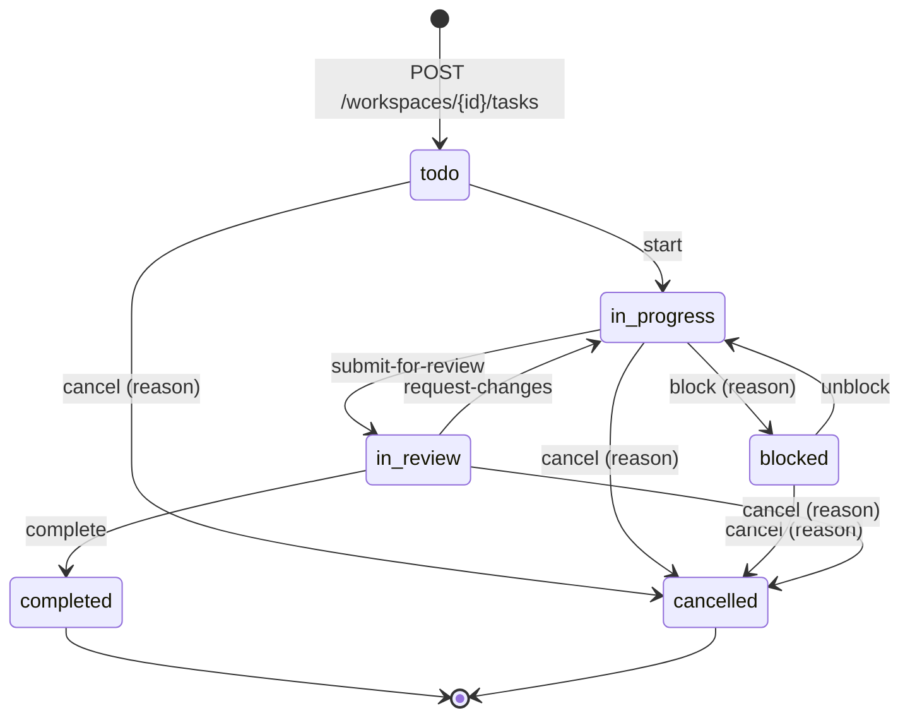
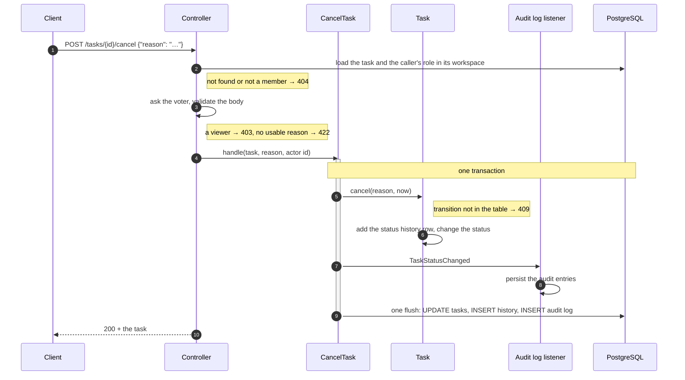

# Architecture

The views follow the [C4 model](https://c4model.com), from the outside in: the system in its
world, the processes it runs as, the modules inside them, then the flows and states that
matter. Each one links the decision record that explains why it looks this way.

## System context

People reach the API only through a client. Three systems outside it get a call: the mail
server, from the worker, when a task gets an assignee
([0024](adr/0024-the-assignee-is-told-by-email-from-the-worker.md)), and Have I Been Pwned,
when someone signs up; if it does not answer, the password is accepted
([0026](adr/0026-new-passwords-checked-against-known-breaches.md)). Stripe takes the
payments: an owner who buys a plan is sent to Stripe's Checkout page, and the card never
reaches the API ([0031](adr/0031-billing-on-stripe-by-plan-tiers.md),
[0032](adr/0032-a-workspace-buys-a-plan-through-stripe-checkout.md)).

## Containers

One codebase runs as two processes: php-fpm answers requests, and the worker handles what
the request does not wait for. A module announces a fact only after its transaction commits
([0023](adr/0023-facts-announced-after-the-commit.md)); the facts with a reaction in the
worker go to RabbitMQ, today only `TaskAssigned`. A message that still fails after its
retries is kept in PostgreSQL.

One database. PostgreSQL also serves the search
([0013](adr/0013-task-search-postgresql-full-text.md)). Redis holds short-lived data: the
blocklist of logged-out access tokens, read on every authenticated request, the rate-limit
counters, the id of each plan's Stripe price for an hour, and in production Doctrine's
cache of query results. In development, Mailpit stands in for the mail server.

php-fpm calls Stripe during the request that opens a payment page, outside any transaction.
Stripe's client waits `STRIPE_TIMEOUT_SECONDS` (30) an attempt with one retry, and nginx
waits 75 seconds for PHP, longer than two attempts, so a call Stripe does not answer
reaches the client as the API's `503` with `Retry-After`, not as nginx's `504`. The
guarantee is per call, not per request: a Stripe slow on several calls in a row can still
end in nginx's `504` ([0032](adr/0032-a-workspace-buys-a-plan-through-stripe-checkout.md)). Of a paying workspace,
PostgreSQL keeps only its Stripe customer's id (`payers`); the invoices stay in Stripe.

## Modules

An arrow reads "depends on". A module owns its slice end to end and registers itself through its own `di.php` and
`routing.php` ([0001](adr/0001-feature-based-modular-monolith.md)). `Shared` depends on no
module, and the audit log on none of the modules that write to it: a record names its
actor by id ([0017](adr/0017-audit-log-as-its-own-module.md)). The allowed
dependencies are declared in `deptrac.php` and checked in CI. `Task` and `Workspace` use
only `Auth`'s contract — an interface for the current user, a lookup by email and the
registration event — and `Task` only `Workspace`'s: a member's role and a reference to
the workspace ([0018](adr/0018-modules-meet-through-contracts.md)). `Notification` reads tasks
and email addresses through contracts and reacts to `Task`'s events in the worker
([0024](adr/0024-the-assignee-is-told-by-email-from-the-worker.md)). `Workspace` asks what a
plan allows through a contract of its own, and `Billing` answers it, so `Workspace` knows
nothing of plans ([0031](adr/0031-billing-on-stripe-by-plan-tiers.md)). `Billing` reads the
buyer's id and email from `Auth`'s contract, asks `Workspace`'s whether a member may manage
billing, and reaches Stripe only through its own `PaymentProvider` port, which
`StripePaymentProvider` implements.

## Reacting to events

Three kinds of class react to an event, and each is named and placed by what it reacts to.

| Reacts to | Runs | Named | Lives in | Example |
|---|---|---|---|---|
| An event of the framework — a request, a response, a login, a JWT | in the request | after what it hooks into, with `Listener` | `EventListener/`, or the folder of its concern in `Shared` | `LogoutListener`, `Shared/Http/RequestIdListener` |
| An event of the application, through the event dispatcher | in the request, in its transaction | after what it does, as a verb | `Listener/`, one class per event | `Task/Listener/AuditLog/LogUpdated`, `Task/Listener/Workspace/UnassignTasksOfMember` |
| An event of the application, through `event.bus` | in the worker, after the commit | after what it does, as a verb | `Handler/`, one class per event | `Notification/Handler/Task/SendTaskAssignedEmail` |

Under `Listener/` and `Handler/`, a reaction to another module's event sits in a folder named
after that module (`Listener/Workspace/`, `Handler/Task/`), and a reaction to the module's own
events in a folder named after its purpose (`Listener/AuditLog/`). A verb names what happens,
so a second reaction to the same event gets a name of its own; a class named after the event
(`TaskAssignedHandler`) would not leave room for it.

## Authentication

Both tokens live in HttpOnly cookies ([0004](adr/0004-access-token-in-httponly-cookie.md));
the refresh cookie is sent only to `/api/v1/auth`.
The access token is short-lived, stateless and signed with RS256: the API's private key signs
it, and the public key is enough to verify it ([0035](adr/0035-access-tokens-signed-with-rs256.md)). The refresh token is stored only as a
SHA-256 hash and rotated on every use, which is what makes a session revocable
([0005](adr/0005-revocable-sessions.md)). The tokens rotated from one sign-in form a family;
a spent one presented again revokes it ([0025](adr/0025-refresh-token-families-and-reuse-detection.md)). The auth endpoints sit behind their own firewall,
so a stale access token cannot block a login or a refresh.

## Task lifecycle

`completed` and `cancelled` are final: nothing leads out of them, and the circle at the
bottom marks the end of a task's life, not a status. The table lives in `TaskTransition`, and the `Task` entity enforces it: it has no status
setter, only `start()`, `submitForReview()`, `complete()`, `requestChanges()`, `block()`, `unblock()` and
`cancel()` ([0015](adr/0015-task-lifecycle-as-explicit-transitions.md),
[0016](adr/0016-blocked-is-a-status-of-work-in-progress.md),
[0030](adr/0030-a-task-in-review-goes-back-to-work.md)). A task's response links the
transitions its status allows, so a client knows which actions to offer.

### What one transition does

The order of the first two steps is deliberate: an invalid body sent to a task of a
workspace the caller is not in answers `404`, not a `422` that would confirm the task
exists ([0011](adr/0011-foreign-task-answers-404.md),
[0020](adr/0020-a-task-belongs-to-a-workspace.md)). The audit entries are written in the same
transaction as the change, so the history cannot disagree with the data
([0012](adr/0012-synchronous-audit-log-one-transaction.md)).
