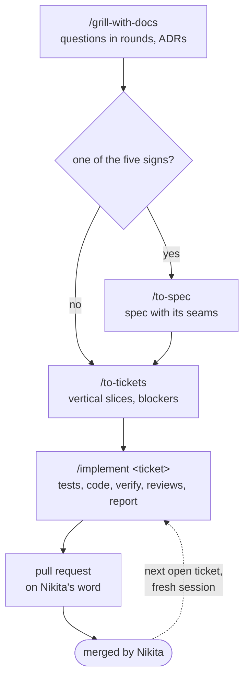

# How a change is built

From an idea to `main`, in the order the skills in `.claude/skills/` run. Nikita starts with
`/grill-with-docs`; each step ends by offering the next, and his "yes" approves the step and
runs the next one, while "stop" approves only. He decides once per step; Claude does the work.

## The steps

| Step | What it does | What Nikita decides |
| --- | --- | --- |
| `/grill-with-docs` | Reads the ADRs, the README, the roadmap and the code; asks the open decisions in rounds, each with its options, costs and a recommendation; checks each answer against the ADRs and the code; writes new terms into `GLOSSARY.md` | An answer to each round, then the summary and the ADR diff, in one message |
| `/to-spec` | Only when the work shows a sign: more than one ticket, two modules or a contract, an asynchronous flow, a rollout in steps, three ADRs. Writes the decisions, the flow across modules, the cases and the seams where each is tested, without a new interview | The spec with its seams |
| `/to-tickets` | Cuts the work into vertical slices, one pull request each, with `blocked-by`, the seam of each case, the modules by name and no file paths | The numbered cut; the tickets are then written `open` |
| `/implement` | Takes an `open` ticket whose blockers are done; tests first at the ticket's seams, then code, `make verify`, a local commit, `project-review` and `security-review`, a report that ends by offering push and the pull request | Push and the pull request, after the report |
| pull request | Described with the `pr` skill; Claude fixes red CI and answers review comments with `answer-review` | The merge, and the review threads left for him |

`/retro` runs when Nikita asks for it, after a change that went harder than it should have.
The `dead-end` skill stops the work when the same fix keeps failing.

A typo, a rename or a comment is made directly. A change without a new design goes straight
to `/implement`, which then writes one plan for Nikita to approve.

## Where things are kept

- ADRs: `docs/adr/`, in git. The grill's edits (the ADR, its row in the table, the
  glossary, the README rule line) stay uncommitted until the first ticket that implements
  them carries them into its pull request; meanwhile they are kept as
  `grill-<topic>.patch` in the tickets' folder, so that nothing is lost when a session or a
  cloud container ends. Exactly one ticket carries the patch, and a later ticket that turns
  one of its ADRs `accepted` is blocked by it.
- Specs and tickets: `/mnt/project-files/tickets/` in a cloud session, `.claude/tickets/`
  locally; neither is in git.
- A branch's plan: `.claude/plans/<branch>.md`; for a ticket it holds only the ticket's
  path.

## A ticket's life

`open` (the cut is approved) → `in-progress` (`/implement` took it) → `done` (its pull
request is on `main`; the next `/implement` marks it). A question left open on purpose is
`waiting` with its `signal:` until Nikita opens it. A spec is `done` when all its tickets
are. An ADR turns `accepted` with the last ticket that implements it.
